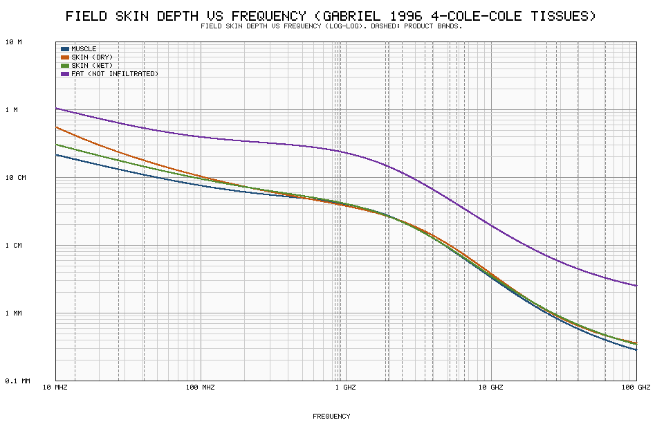

# Frequency-versus-absorption comparison (first-order estimate)

> **Not medical advice. Not a regulatory determination.** This table is a first-order plane-wave estimate for a homogeneous tissue half-space. It is not a whole-body human phantom, not a model of a phone or tower, and not a substitute for openEMS or Meep. It cannot show why a product band was chosen, and it cannot show that a frequency is “safer.” “Safer frequency” is treated here as a **claim to test** against opened sources and the model assumptions listed below, not as a result of this script.

## Per-case rule (t1201u)

Cancers are not always caused by one thing, and they can be caused by different things in different areas of the body. Every cause and claimed cure in this repository is recorded by **cancer type** and **body site**. This page is a dosimetry *estimate*, not an epidemiology finding, so **cancer type** is marked not applicable. Each row is still tied to one Gabriel Table 1 **tissue / body site** (muscle, dry skin, wet skin, or fat). Results are not averaged into one “the body” number, and they are not a claim about cancer at any site.

## What was computed

- Dielectric parameters from the 4-Cole-Cole model and Table 1 of Gabriel, Lau and Gabriel, *Phys. Med. Biol.* 41 (1996) 2271–2293, opened as the publisher PDF (https://iopscience.iop.org/article/10.1088/0031-9155/41/11/003/pdf, DOI https://doi.org/10.1088/0031-9155/41/11/003). The FCC page https://www.fcc.gov/general/body-tissue-dielectric-parameters states that its public calculator uses the same model (AFOSR-TR-96) and is limited to 10–6000 MHz. Frequencies outside that window are labeled; they still use the opened PMB model, which the paper states covers 10 Hz–100 GHz.
- Field skin depth δ = 1/α for a normally incident plane wave on a homogeneous half-space of that one tissue.
- A **simplified whole-body SAR estimate**: the depth average of SAR(z) = σ |E(z)|² / ρ over a 0.30 m slab, with incident power density S0 = 1 W m⁻² (a normalization, not a limit) and ρ = 1000 kg m⁻³ (a conventional water-like density; Gabriel 1996 Table 1 does not report mass density). Surface SAR and the average over one skin depth are listed for context. The 0.30 m length is a body-scale illustration, not an anatomical model and not an FCC or ICNIRP averaging mass.
- Representative frequencies are midpoints (or identified ISM centers) of bands **named in opened allocation records** (ISM, cellular, Broadband PCS, Wi-Fi / U-NII, 3.45 GHz and 3.7 GHz Service, Upper Microwave Flexible Use). Full citations are in [frequency-absorption-method.md](frequency-absorption-method.md) and in the CSV.
- IT'IS parameters are **not** used. This script is MIT-licensed and is not a medical or regulatory conclusion.

How to regenerate (from the repository root, stdlib only):

```
python3 -m tools.frequency_absorption
```

See [frequency-absorption-method.md](frequency-absorption-method.md) for quoted formulas and source URLs.

## Plot



An SVG copy of the same figure is in [frequency-absorption.svg](frequency-absorption.svg). The dashed lines mark the representative product-band frequencies in the table; they are not absorption peaks.

## Band list (opened records)

| Service | Representative frequency | Opened range | Citation |
| --- | --- | --- | --- |
| ISM | 13.56 MHz | 13.56 MHz (center; 13.553–13.567 MHz at ±0.05%) | 47 CFR § 18.301 (eCFR, opened 19 Nov 2026) |
| ISM | 27.12 MHz | 27.12 MHz (center; 26.957–27.283 MHz at ±0.6%) | 47 CFR § 18.301 (eCFR, opened 19 Nov 2026) |
| ISM | 40.68 MHz | 40.68 MHz (center; 40.66–40.70 MHz at ±0.05%) | 47 CFR § 18.301 (eCFR, opened 19 Nov 2026) |
| Cellular | 836.5 MHz | 824–849 MHz (mobile transmit / uplink span of Blocks A and B) | 47 CFR § 22.905 (eCFR, opened 19 Nov 2026) |
| Cellular | 881.5 MHz | 869–894 MHz (base transmit / downlink span of Blocks A and B) | 47 CFR § 22.905 (eCFR, opened 19 Nov 2026) |
| ISM / Part 15 | 915 MHz | 915 MHz ISM center (±13 MHz); also 902–928 MHz in § 15.247 | 47 CFR § 18.301 (eCFR) and 47 CFR § 15.247 (LII, opened 19 Nov 2026; https://www.law.cornell.edu/cfr/text/47/15.247) |
| Broadband PCS | 1.8775 GHz | 1870–1885 MHz (Block B, first of the paired ranges) | 47 CFR § 24.229 (LII, opened 19 Nov 2026) |
| Broadband PCS | 1.9575 GHz | 1950–1965 MHz (Block B, paired range) | 47 CFR § 24.229 (LII, opened 19 Nov 2026) |
| Wi-Fi / Part 15 | 2.44175 GHz | 2400–2483.5 MHz | 47 CFR § 15.247 (LII, opened 19 Nov 2026) |
| 3.45 GHz Service | 3.5 GHz | 3450–3550 MHz | 47 CFR § 27.5(o) (LII, opened 19 Nov 2026) |
| 3.7 GHz Service | 3.92 GHz | 3700–4140 MHz (Blocks A–E) | 47 CFR § 27.5(m) (LII, opened 19 Nov 2026) |
| U-NII / Wi-Fi | 5.2 GHz | 5.15–5.25 GHz | 47 CFR § 15.407 (LII, opened 19 Nov 2026) |
| ISM / U-NII | 5.8 GHz | 5800 MHz ISM center (±75 MHz); 5.725–5.850 GHz in §§ 15.247 and 15.407 | 47 CFR § 18.301 (eCFR); 47 CFR §§ 15.247 and 15.407 (LII, opened 19 Nov 2026) |
| U-NII / Wi-Fi 6E | 6.525 GHz | 5.925–7.125 GHz | 47 CFR § 15.407 (LII, opened 19 Nov 2026) |
| ISM | 24.125 GHz | 24.125 GHz (center; 24.000–24.250 GHz at ±125 MHz) | 47 CFR § 18.301 (eCFR, opened 19 Nov 2026) |
| Upper Microwave Flexible Use (5G) | 27.925 GHz | 27.5–28.35 GHz | 47 CFR § 30.4(c) (LII, opened 19 Nov 2026) |
| Upper Microwave Flexible Use (5G) | 39.3 GHz | 38.6–40 GHz | 47 CFR § 30.4(d) (LII, opened 19 Nov 2026) |
| ISM | 61.25 GHz | 61.25 GHz (center; 61.000–61.500 GHz at ±250 MHz) | 47 CFR § 18.301 (eCFR, opened 19 Nov 2026) |

## Muscle

| Representative frequency | Service | Skin depth | Surface SAR estimate (W kg⁻¹) | SAR average over one skin depth (W kg⁻¹) | Simplified whole-body SAR estimate, 0.30 m slab (W kg⁻¹) | Absorbed power density (W m⁻²) | Frequency-range flag |
| --- | --- | --- | --- | --- | --- | --- | --- |
| 13.56 MHz | ISM | 18.7 cm | 1.064e-03 | 4.601e-04 | 3.188e-04 | 9.968e-02 | inside FCC calculator 10–6000 MHz window |
| 27.12 MHz | ISM | 13.3 cm | 2.063e-03 | 8.918e-04 | 4.533e-04 | 1.375e-01 | inside FCC calculator 10–6000 MHz window |
| 40.68 MHz | ISM | 11.1 cm | 3.004e-03 | 1.299e-03 | 5.511e-04 | 1.661e-01 | inside FCC calculator 10–6000 MHz window |
| 836.5 MHz | Cellular | 4.35 cm | 1.859e-02 | 8.036e-03 | 1.346e-03 | 4.038e-01 | inside FCC calculator 10–6000 MHz window |
| 881.5 MHz | Cellular | 4.27 cm | 1.898e-02 | 8.207e-03 | 1.350e-03 | 4.050e-01 | inside FCC calculator 10–6000 MHz window |
| 915 MHz | ISM / Part 15 | 4.21 cm | 1.928e-02 | 8.335e-03 | 1.353e-03 | 4.059e-01 | inside FCC calculator 10–6000 MHz window |
| 1.8775 GHz | Broadband PCS | 2.83 cm | 2.945e-02 | 1.273e-02 | 1.387e-03 | 4.162e-01 | inside FCC calculator 10–6000 MHz window |
| 1.9575 GHz | Broadband PCS | 2.73 cm | 3.048e-02 | 1.318e-02 | 1.389e-03 | 4.166e-01 | inside FCC calculator 10–6000 MHz window |
| 2.44175 GHz | Wi-Fi / Part 15 | 2.24 cm | 3.736e-02 | 1.615e-02 | 1.395e-03 | 4.186e-01 | inside FCC calculator 10–6000 MHz window |
| 3.5 GHz | 3.45 GHz Service | 1.5 cm | 5.620e-02 | 2.430e-02 | 1.406e-03 | 4.218e-01 | inside FCC calculator 10–6000 MHz window |
| 3.92 GHz | 3.7 GHz Service | 1.3 cm | 6.506e-02 | 2.813e-02 | 1.410e-03 | 4.229e-01 | inside FCC calculator 10–6000 MHz window |
| 5.2 GHz | U-NII / Wi-Fi | 8.83 mm | 9.647e-02 | 4.171e-02 | 1.420e-03 | 4.260e-01 | inside FCC calculator 10–6000 MHz window |
| 5.8 GHz | ISM / U-NII | 7.54 mm | 1.133e-01 | 4.899e-02 | 1.425e-03 | 4.274e-01 | inside FCC calculator 10–6000 MHz window |
| 6.525 GHz | U-NII / Wi-Fi 6E | 6.34 mm | 1.353e-01 | 5.850e-02 | 1.430e-03 | 4.291e-01 | outside FCC calculator 10–6000 MHz window; inside PMB model range |
| 24.125 GHz | ISM | 1 mm | 9.431e-01 | 4.077e-01 | 1.576e-03 | 4.727e-01 | outside FCC calculator 10–6000 MHz window; inside PMB model range |
| 27.925 GHz | Upper Microwave Flexible Use (5G) | 846 µm | 1.140e+00 | 4.927e-01 | 1.607e-03 | 4.822e-01 | outside FCC calculator 10–6000 MHz window; inside PMB model range |
| 39.3 GHz | Upper Microwave Flexible Use (5G) | 593 µm | 1.718e+00 | 7.429e-01 | 1.697e-03 | 5.091e-01 | outside FCC calculator 10–6000 MHz window; inside PMB model range |
| 61.25 GHz | ISM | 403 µm | 2.750e+00 | 1.189e+00 | 1.848e-03 | 5.543e-01 | outside FCC calculator 10–6000 MHz window; inside PMB model range |

*Body site:* Table 1 row 'Muscle'. A homogeneous-muscle half-space is a common first-order proxy, not a model of a particular organ.

Incident S0 = 1 W m⁻²; ρ = 1000 kg m⁻³ (conventional). Estimates scale linearly with S0.

## Skin (dry)

| Representative frequency | Service | Skin depth | Surface SAR estimate (W kg⁻¹) | SAR average over one skin depth (W kg⁻¹) | Simplified whole-body SAR estimate, 0.30 m slab (W kg⁻¹) | Absorbed power density (W m⁻²) | Frequency-range flag |
| --- | --- | --- | --- | --- | --- | --- | --- |
| 13.56 MHz | ISM | 42 cm | 7.729e-04 | 3.342e-04 | 4.116e-04 | 1.625e-01 | inside FCC calculator 10–6000 MHz window |
| 27.12 MHz | ISM | 23.9 cm | 1.630e-03 | 7.048e-04 | 5.966e-04 | 1.948e-01 | inside FCC calculator 10–6000 MHz window |
| 40.68 MHz | ISM | 18 cm | 2.438e-03 | 1.054e-03 | 7.046e-04 | 2.192e-01 | inside FCC calculator 10–6000 MHz window |
| 836.5 MHz | Cellular | 4.15 cm | 2.133e-02 | 9.221e-03 | 1.474e-03 | 4.423e-01 | inside FCC calculator 10–6000 MHz window |
| 881.5 MHz | Cellular | 4.06 cm | 2.190e-02 | 9.468e-03 | 1.481e-03 | 4.444e-01 | inside FCC calculator 10–6000 MHz window |
| 915 MHz | ISM / Part 15 | 4 cm | 2.232e-02 | 9.649e-03 | 1.486e-03 | 4.458e-01 | inside FCC calculator 10–6000 MHz window |
| 1.8775 GHz | Broadband PCS | 2.75 cm | 3.389e-02 | 1.465e-02 | 1.553e-03 | 4.658e-01 | inside FCC calculator 10–6000 MHz window |
| 1.9575 GHz | Broadband PCS | 2.67 cm | 3.491e-02 | 1.509e-02 | 1.555e-03 | 4.666e-01 | inside FCC calculator 10–6000 MHz window |
| 2.44175 GHz | Wi-Fi / Part 15 | 2.26 cm | 4.154e-02 | 1.796e-02 | 1.567e-03 | 4.702e-01 | inside FCC calculator 10–6000 MHz window |
| 3.5 GHz | 3.45 GHz Service | 1.61 cm | 5.898e-02 | 2.550e-02 | 1.583e-03 | 4.750e-01 | inside FCC calculator 10–6000 MHz window |
| 3.92 GHz | 3.7 GHz Service | 1.42 cm | 6.712e-02 | 2.902e-02 | 1.588e-03 | 4.763e-01 | inside FCC calculator 10–6000 MHz window |
| 5.2 GHz | U-NII / Wi-Fi | 9.96 mm | 9.623e-02 | 4.160e-02 | 1.598e-03 | 4.794e-01 | inside FCC calculator 10–6000 MHz window |
| 5.8 GHz | ISM / U-NII | 8.58 mm | 1.121e-01 | 4.845e-02 | 1.602e-03 | 4.806e-01 | inside FCC calculator 10–6000 MHz window |
| 6.525 GHz | U-NII / Wi-Fi 6E | 7.25 mm | 1.330e-01 | 5.750e-02 | 1.607e-03 | 4.820e-01 | outside FCC calculator 10–6000 MHz window; inside PMB model range |
| 24.125 GHz | ISM | 1.09 mm | 9.625e-01 | 4.161e-01 | 1.749e-03 | 5.247e-01 | outside FCC calculator 10–6000 MHz window; inside PMB model range |
| 27.925 GHz | Upper Microwave Flexible Use (5G) | 922 µm | 1.162e+00 | 5.024e-01 | 1.786e-03 | 5.357e-01 | outside FCC calculator 10–6000 MHz window; inside PMB model range |
| 39.3 GHz | Upper Microwave Flexible Use (5G) | 658 µm | 1.727e+00 | 7.467e-01 | 1.895e-03 | 5.684e-01 | outside FCC calculator 10–6000 MHz window; inside PMB model range |
| 61.25 GHz | ISM | 472 µm | 2.651e+00 | 1.146e+00 | 2.084e-03 | 6.253e-01 | outside FCC calculator 10–6000 MHz window; inside PMB model range |

*Body site:* Table 1 row 'Skin (dry)'. Superficial tissue; not whole-body.

Incident S0 = 1 W m⁻²; ρ = 1000 kg m⁻³ (conventional). Estimates scale linearly with S0.

## Skin (wet)

| Representative frequency | Service | Skin depth | Surface SAR estimate (W kg⁻¹) | SAR average over one skin depth (W kg⁻¹) | Simplified whole-body SAR estimate, 0.30 m slab (W kg⁻¹) | Absorbed power density (W m⁻²) | Frequency-range flag |
| --- | --- | --- | --- | --- | --- | --- | --- |
| 13.56 MHz | ISM | 26.1 cm | 1.002e-03 | 4.330e-04 | 3.924e-04 | 1.309e-01 | inside FCC calculator 10–6000 MHz window |
| 27.12 MHz | ISM | 18 cm | 1.920e-03 | 8.301e-04 | 5.549e-04 | 1.726e-01 | inside FCC calculator 10–6000 MHz window |
| 40.68 MHz | ISM | 14.6 cm | 2.770e-03 | 1.198e-03 | 6.637e-04 | 2.025e-01 | inside FCC calculator 10–6000 MHz window |
| 836.5 MHz | Cellular | 4.47 cm | 1.923e-02 | 8.312e-03 | 1.433e-03 | 4.298e-01 | inside FCC calculator 10–6000 MHz window |
| 881.5 MHz | Cellular | 4.37 cm | 1.974e-02 | 8.532e-03 | 1.438e-03 | 4.314e-01 | inside FCC calculator 10–6000 MHz window |
| 915 MHz | ISM / Part 15 | 4.3 cm | 2.011e-02 | 8.696e-03 | 1.441e-03 | 4.324e-01 | inside FCC calculator 10–6000 MHz window |
| 1.8775 GHz | Broadband PCS | 2.79 cm | 3.210e-02 | 1.388e-02 | 1.490e-03 | 4.470e-01 | inside FCC calculator 10–6000 MHz window |
| 1.9575 GHz | Broadband PCS | 2.69 cm | 3.325e-02 | 1.437e-02 | 1.492e-03 | 4.476e-01 | inside FCC calculator 10–6000 MHz window |
| 2.44175 GHz | Wi-Fi / Part 15 | 2.21 cm | 4.080e-02 | 1.764e-02 | 1.502e-03 | 4.506e-01 | inside FCC calculator 10–6000 MHz window |
| 3.5 GHz | 3.45 GHz Service | 1.5 cm | 6.090e-02 | 2.633e-02 | 1.518e-03 | 4.553e-01 | inside FCC calculator 10–6000 MHz window |
| 3.92 GHz | 3.7 GHz Service | 1.3 cm | 7.019e-02 | 3.035e-02 | 1.523e-03 | 4.568e-01 | inside FCC calculator 10–6000 MHz window |
| 5.2 GHz | U-NII / Wi-Fi | 8.97 mm | 1.028e-01 | 4.443e-02 | 1.536e-03 | 4.609e-01 | inside FCC calculator 10–6000 MHz window |
| 5.8 GHz | ISM / U-NII | 7.71 mm | 1.201e-01 | 5.191e-02 | 1.542e-03 | 4.627e-01 | inside FCC calculator 10–6000 MHz window |
| 6.525 GHz | U-NII / Wi-Fi 6E | 6.52 mm | 1.425e-01 | 6.162e-02 | 1.549e-03 | 4.648e-01 | outside FCC calculator 10–6000 MHz window; inside PMB model range |
| 24.125 GHz | ISM | 1.12 mm | 9.245e-01 | 3.997e-01 | 1.721e-03 | 5.164e-01 | outside FCC calculator 10–6000 MHz window; inside PMB model range |
| 27.925 GHz | Upper Microwave Flexible Use (5G) | 952 µm | 1.107e+00 | 4.788e-01 | 1.757e-03 | 5.272e-01 | outside FCC calculator 10–6000 MHz window; inside PMB model range |
| 39.3 GHz | Upper Microwave Flexible Use (5G) | 681 µm | 1.636e+00 | 7.072e-01 | 1.857e-03 | 5.572e-01 | outside FCC calculator 10–6000 MHz window; inside PMB model range |
| 61.25 GHz | ISM | 476 µm | 2.547e+00 | 1.101e+00 | 2.020e-03 | 6.061e-01 | outside FCC calculator 10–6000 MHz window; inside PMB model range |

*Body site:* Table 1 row 'Skin (wet)'. Superficial tissue; not whole-body.

Incident S0 = 1 W m⁻²; ρ = 1000 kg m⁻³ (conventional). Estimates scale linearly with S0.

## Fat (not infiltrated)

| Representative frequency | Service | Skin depth | Surface SAR estimate (W kg⁻¹) | SAR average over one skin depth (W kg⁻¹) | Simplified whole-body SAR estimate, 0.30 m slab (W kg⁻¹) | Absorbed power density (W m⁻²) | Frequency-range flag |
| --- | --- | --- | --- | --- | --- | --- | --- |
| 13.56 MHz | ISM | 90.7 cm | 8.580e-04 | 3.710e-04 | 6.277e-04 | 3.890e-01 | inside FCC calculator 10–6000 MHz window |
| 27.12 MHz | ISM | 64.4 cm | 1.532e-03 | 6.624e-04 | 9.964e-04 | 4.930e-01 | inside FCC calculator 10–6000 MHz window |
| 40.68 MHz | ISM | 53.9 cm | 2.084e-03 | 9.009e-04 | 1.257e-03 | 5.618e-01 | inside FCC calculator 10–6000 MHz window |
| 836.5 MHz | Cellular | 25.2 cm | 6.624e-03 | 2.864e-03 | 2.523e-03 | 8.338e-01 | inside FCC calculator 10–6000 MHz window |
| 881.5 MHz | Cellular | 24.6 cm | 6.774e-03 | 2.929e-03 | 2.538e-03 | 8.343e-01 | inside FCC calculator 10–6000 MHz window |
| 915 MHz | ISM / Part 15 | 24.2 cm | 6.888e-03 | 2.978e-03 | 2.548e-03 | 8.347e-01 | inside FCC calculator 10–6000 MHz window |
| 1.8775 GHz | Broadband PCS | 15.1 cm | 1.110e-02 | 4.799e-03 | 2.747e-03 | 8.402e-01 | inside FCC calculator 10–6000 MHz window |
| 1.9575 GHz | Broadband PCS | 14.6 cm | 1.153e-02 | 4.983e-03 | 2.756e-03 | 8.405e-01 | inside FCC calculator 10–6000 MHz window |
| 2.44175 GHz | Wi-Fi / Part 15 | 11.7 cm | 1.434e-02 | 6.201e-03 | 2.790e-03 | 8.421e-01 | inside FCC calculator 10–6000 MHz window |
| 3.5 GHz | 3.45 GHz Service | 7.79 cm | 2.171e-02 | 9.385e-03 | 2.816e-03 | 8.451e-01 | inside FCC calculator 10–6000 MHz window |
| 3.92 GHz | 3.7 GHz Service | 6.76 cm | 2.503e-02 | 1.082e-02 | 2.820e-03 | 8.462e-01 | inside FCC calculator 10–6000 MHz window |
| 5.2 GHz | U-NII / Wi-Fi | 4.68 cm | 3.628e-02 | 1.568e-02 | 2.831e-03 | 8.494e-01 | inside FCC calculator 10–6000 MHz window |
| 5.8 GHz | ISM / U-NII | 4.05 cm | 4.204e-02 | 1.818e-02 | 2.836e-03 | 8.509e-01 | inside FCC calculator 10–6000 MHz window |
| 6.525 GHz | U-NII / Wi-Fi 6E | 3.46 cm | 4.935e-02 | 2.133e-02 | 2.842e-03 | 8.526e-01 | outside FCC calculator 10–6000 MHz window; inside PMB model range |
| 24.125 GHz | ISM | 7.02 mm | 2.520e-01 | 1.090e-01 | 2.948e-03 | 8.843e-01 | outside FCC calculator 10–6000 MHz window; inside PMB model range |
| 27.925 GHz | Upper Microwave Flexible Use (5G) | 6.09 mm | 2.919e-01 | 1.262e-01 | 2.964e-03 | 8.891e-01 | outside FCC calculator 10–6000 MHz window; inside PMB model range |
| 39.3 GHz | Upper Microwave Flexible Use (5G) | 4.54 mm | 3.968e-01 | 1.716e-01 | 3.002e-03 | 9.006e-01 | outside FCC calculator 10–6000 MHz window; inside PMB model range |
| 61.25 GHz | ISM | 3.32 mm | 5.502e-01 | 2.379e-01 | 3.048e-03 | 9.145e-01 | outside FCC calculator 10–6000 MHz window; inside PMB model range |

*Body site:* Table 1 row 'Fat (not infiltrated)'. Adipose tissue; not a whole-body average.

Incident S0 = 1 W m⁻²; ρ = 1000 kg m⁻³ (conventional). Estimates scale linearly with S0.

## What this does not show

- It does not show that any product band was chosen because it couples more, or less, to tissue.
- It does not rank frequencies as safer or more dangerous.
- It does not replace a full-wave simulation of a person and a device, and it does not use IT'IS voxel models.
- Fat (infiltrated) is included in the CSV but omitted from the compact tables above to keep the page short; regenerate the CSV to inspect it.

Machine-readable values: [frequency-absorption.csv](frequency-absorption.csv). Method and quoted formulas: [frequency-absorption-method.md](frequency-absorption-method.md).
